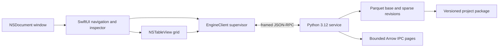

# Architecture

The Swift application owns native document windows, UI metadata, viewport cache, undo history and user-facing state. The Python service owns typed immutable revisions and file execution. Foundation protocols live in OpenStatCore and EngineClient, both Swift Package libraries reused by the Xcode application target.

The native viewport reads bounded Arrow IPC files off the UI actor, validates checksums, schema and stable row IDs, then releases the engine artifact. The original Swift reader accepts only the engine’s uncompressed V5 physical types, rejecting dictionaries, compression and unsupported nesting. No third-party Swift parser is embedded. The UI keeps at most eight 128-row pages, not the entire dataset. Parquet row-group metadata lets paging skip preceding groups. Stable sorting uses bounded Parquet runs and a capped merge fan-in. Table joins are exact but explicitly limited to 100,000 cases; they do not claim a large-table spill implementation. Metadata caching keeps two immutable file footers with independent readers.

Each cell edit creates a revision and sparse overlay. Prior revisions remain readable for undo. The base file is not rewritten on every edit. Project open copies its immutable base to a private session cache so external source replacement cannot silently change an active session. Analysis code has not been added.

The local contributor app references a Python virtual environment in the source checkout. Runtime relocation, full component-license review, native arm64 execution and distributable packaging remain distinct future gates. Process separation is not an operating-system security sandbox.
