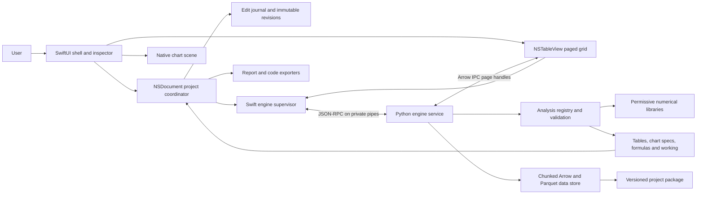

# OpenStat Mac implementation plan

Date: 2026-10-14 (Europe/Prague). Status: implementation authorized on 2026-10-14; Phase 0 is active. Distribution decision updated: the user has no Developer ID and wants an open-source GitHub route. This document follows the feature audit. A first contributor data-editor slice now exists. See VALIDATION.md and SESSION_STATUS.md for measured results and unresolved gates.

## 1. Proposed decisions

Use an original native document application for macOS 14+, written in Swift with SwiftUI for navigation and forms, AppKit for document lifecycle and the virtualized grid, and Swift Charts/Core Graphics for charts. Use a separate Python 3.12 engine over JSON-RPC 2.0 on inherited process pipes. Use Arrow IPC for grid pages and Parquet for durable data. JSON carries metadata and small results, never full datasets.

Prefer separate arm64 and x86_64 releases initially. This avoids pretending that a universal Swift executable makes its bundled Python extensions universal. A universal release is allowed only after every embedded Mach-O dependency is validated for both architectures. All feature work proceeds Phase 0, then 1, then 2, then 3, then 4, then 5. A phase gate must pass before the next phase starts.

Use MIT for original code unless the user chooses Apache-2.0. The code-start instruction adopts the recommended MIT choice; LICENSE records it. The development stack follows the reviewed-permissive approach: Python uses PSF and historical license terms, rather than exclusively BSD/MIT/Apache. SQLite is public domain; runtime and wheel artifacts can include other component licenses. Use individually reviewed permissive dependencies and exclude all copyleft components. Exact distribution artifacts remain unapproved until their audit passes. This is not approval to bundle an unaudited Python distribution. See [CPython license](https://docs.python.org/3.12/license.html) and [standalone distribution metadata](https://github.com/astral-sh/python-build-standalone/blob/main/docs/distributions.rst).

Default app language follows macOS, with complete English and Czech coverage and an app-language override. Default sample variance uses n−1; a population-context analysis defaults to n and labels the choice. The saved specification always records the actual convention. Default quantiles use Hyndman-Fan type 7 (`linear`); all nine types remain available. These are proposals, not historical compatibility claims.

Keep the working name in one product configuration and localization key. Do not add vendor branding to app labels, sample files, artwork or package identifiers. Research citations in audit documents are provenance only. Do not consume proprietary datasets, binaries or internal formats.

## 2. Architecture and ownership



The Swift document coordinator owns user edits, undo history, UI state, coordinated saves and analysis history. The Python store owns typed dataset execution and numerical transformations. It cannot silently mutate an analysis's source revision. The engine registry owns validation, methods, numerical conventions and original explanations. Exporters consume the same immutable result model used by the UI.

Use `NSDocument` with SwiftUI hosting, rather than a large `FileDocument` value that copies a multimillion-row project into Swift memory. Native document windows support tabs, autosave and coordinated file operations. Separate documents receive separate supervised engine sessions initially. Read-only windows of the same document share a coordinator. Revisit a global service only if measured memory requires it.

Charts receive numerical values and declarative series from the engine. A platform-independent scene model holds axes, ticks, marks, annotations, units and accessibility descriptions. Swift Charts handles supported primitives; custom Core Graphics renderers cover box, Q-Q, radar and dendrogram geometry. A Metal renderer is reserved for later 3D work. PNG, PDF and SVG share scene data and formatting. Do not use screen captures as vector exports.

See [Apple NSDocument](https://developer.apple.com/documentation/appkit/nsdocument), [NSTableView](https://developer.apple.com/documentation/appkit/nstableview), [Swift Charts](https://developer.apple.com/documentation/charts) and [Arrow dataset scans](https://arrow.apache.org/docs/python/dataset.html).

## 3. Proposed repository layout

```text
OpenStat-Mac/
  README.md
  LICENSE
  CONTRIBUTING.md
  CODE_OF_CONDUCT.md
  SECURITY.md
  CHANGELOG.md
  THIRD_PARTY_LICENSES.md
  AGENTS.md
  Makefile
  Package.swift
  OpenStatMac.xcodeproj/
  Config/
    Product.xcconfig
    Entitlements.plist
    PythonHelper.entitlements
  App/
    OpenStatMacApp.swift
    Documents/
    Navigation/
    Inspector/
    Grid/
    Results/
    Resources/Localizable.xcstrings
  Sources/
    OpenStatCore/                 # Codable specs, domain types, revisions
    EngineClient/                 # framing, supervisor, lifecycle, requests
    DataGrid/                     # AppKit bridge, page cache, editor
    ChartScene/                   # marks, geometry, SVG and PDF adapters
    LearningContent/              # original keyed content and formula models
  Tests/
    OpenStatCoreTests/
    EngineClientTests/
    DataGridTests/
    AppUITests/                   # Xcode test target
  Extensions/
    QuickLook/                    # bounded, engine-free project preview
  engine/
    pyproject.toml
    src/openstat_engine/
      cli.py
      rpc/
      schema/
      store/
      expressions/
      analyses/
      explanations/
      reporting/
      plugins/
    tests/
      unit/
      integration/
      reference/
      performance/
    fixtures/
      fundamentals/
      nist/
      rpc/
      projects/
  schemas/
    manifest.schema.json
    analysis.schema.json
    result.schema.json
    plugin.schema.json
  docs/
    FEATURE_MATRIX.md
    feature_catalog.json
    SOURCES.md
    IMPLEMENTATION_PLAN.md
    ARCHITECTURE.md
    RPC.md
    PROJECT_FORMAT.md
    NUMERICAL_CONVENTIONS.md
    LOCALIZATION.md
    RELEASE.md
    ADD_ANALYSIS.md
  scripts/
    check_feature_matrix.py
    package_runtime.py
    verify_licenses.py
    sign_bundle.sh
    make_dmg.sh
    benchmark.py
  .github/
    workflows/ci.yml
    workflows/release.yml
    ISSUE_TEMPLATE/
    PULL_REQUEST_TEMPLATE.md
    dependabot.yml
```

This tree is proposed. The current deliverable contains planning files and the first Phase 0 contributor slice. Source targets and initial check automation now exist; unimplemented targets remain on the roadmap. Use Swift Package Manager for independently tested libraries and an Xcode application project for document targets, UI tests, signing and Quick Look. Keep package language compatibility at Swift 5.9 where feasible; build with a selected Xcode version that supports the target OS. Do not assume current Swift 6 toolchain behavior is identical to Swift 5.9.

`AGENTS.md` will require original content, permissive dependency review, stable feature IDs, phase gates, no fixture fabrication, numerical convention labels, localization keys, accessibility acceptance and tests before status promotion. Use normal prose in repository files and Conventional Commits, even when chat is terse.

## 4. Dataset model and large-data strategy

A dataset has a UUID, revision, observation-unit description, population/sample/unspecified context, row count, immutable field UUIDs, codebook, data fragments, lineage and content hashes. Field display names can change without invalidating specs. Row IDs are stable opaque identifiers, including after sorting and filtering.

Separate physical storage types from measurement properties:

- Storage: Boolean, int64, float64, decimal where required, UTF-8, date/time and list values.
- Role: identifier or characteristic. Identifier fields do not become analyzable merely because stored as integers.
- Measurement: continuous numeric, discrete numeric, ordinal, binary categorical, nominal categorical, and a multiple-response set. Do not equate a multilevel category with multiple responses.
- Codebook: ordered levels, value labels, units, named missing codes and original raw-value provenance.

Physical nulls and user-coded missing states remain distinguishable. Infinity is an explicit invalid/nonfinite condition, not an undeclared missing code. Analysis eligibility is determined jointly by field role, scale, statistical method and saved missing/weight policy. Users can override a measurement designation deliberately; the override is recorded.

Typed formulas use a small parsed expression language. No `eval`, Python source execution or arbitrary shell interpolation. Limit expression depth, functions and memory. Store locale-independent literals and identifiers. Display comma decimals in Czech but require clear delimiter/decimal choices for ambiguous CSV. CSV auto-detection proposes a schema; the user confirms lossy or ambiguous coercions. Preserve source file and record parser options.

Keep Parquet fragments immutable. Edits form a sparse overlay journal; compaction writes a new revision. Pending compacted fragments become visible only after atomic manifest publication. Undo references the previous edit state, not a full copy of the table. Draft analysis caches are tied to revision hashes and become visibly stale after changes.

Use Arrow record batches for scans and streamed aggregation. A viewport requests only visible fields and rows plus a small prefetch region. Python returns an Arrow IPC page handle in a session cache; a Swift decoder reads only that bounded page. Phase 0 must evaluate a permissive Swift Arrow decoder against the required physical types. If a full compatible decoder is unavailable, implement a documented minimal bounded Arrow IPC reader and test interoperability; do not invent a new “Arrow-like” format. Small JSON pages can be a clearly labeled developer fallback, never the released large-data path.

Do not load 5M × 100 into pandas unconditionally. The raw float64 values alone occupy about 4,000,000,000 bytes before metadata, missing masks or copies; this is a capacity estimate, not a benchmark. Projected scan and sufficient-statistic reductions handle descriptive summaries. Exact quantiles require an external sort or a validated bounded-memory exact algorithm. A sampled/approximate quantile must be visibly labeled and cannot satisfy an exact method contract.

Global sort and join need disk-backed spill with deterministic row IDs; Arrow dataset support does not automatically supply this. The initial plan is external sorted runs and a merge executor using Arrow batches. pandas handles operations only when size limits pass. Transpose must warn about the resulting column count and permit cancellation. Later models that require dense matrices declare a size estimate and supported capacity before allocation.

Chart previews use documented sampling, binning or aggregation when the source is large. Results remain exact unless explicitly requested otherwise. Brushing sampled charts selects represented row IDs only. Preview and result metadata disclose sampling. An analysis job operates on a frozen revision while edits continue in a new revision.

## 5. Analysis and result contracts

An analysis specification contains:

- `schema_version`, `analysis_id`, stable `method_id`, module implementation version.
- Dataset UUID, immutable revision and content hash; selected field UUIDs and selection expression hash.
- Validated method parameters, confidence/tail choice where relevant and weight semantics.
- Missing policy, population/sample context, variance divisor and quantile method.
- Random generator name and seed for stochastic procedures.
- Engine/dependency versions and requested output blocks.

An immutable result contains typed tables, declarative chart specs, explanatory notes, diagnostics, units, effective counts and reproducibility metadata. Number storage remains full precision; rounding is a display policy. Tables distinguish absent, undefined, nonfinite and not-applicable values using `null` plus a reason code. Never transmit NaN/Infinity as invalid JSON numbers. The localized text is generated from message keys and arguments, not parsed out of an English string.

The learning model records a formula, symbol glossary, inclusion/exclusion counts, sufficient statistics, substitutions, intermediate values, final value and exact/approximate classification. Small datasets show every arithmetic step. Large datasets show sufficient-statistic working and clearly label any row excerpt. They do not claim that a small excerpt was the calculation's complete input. Numerical step values come from the same intermediate computation, while independent fixtures test the formulas.

A result workbook is a sequence of blocks with stable IDs. Tables, charts, text notes and collapsible sections can be reordered and annotated. User annotations are separate from computed result content and survive reruns. Rerun appends a revision and explicitly preserves or rebinds annotations. Descriptive-only outputs remain distinct from inference; the UI cannot imply causal claims from a correlation or p-value.

## 6. RPC draft

Use JSON-RPC 2.0 over process stdin/stdout with `Content-Length` headers and UTF-8 JSON, not line-delimited data mixed with logging. stdout is protocol only; stderr carries structured diagnostics with no automatic dataset values. Swift launches the bundled interpreter directly with fixed arguments and a cleaned environment. Never search user PATH for release runtime.

Handshake `engine.hello` negotiates protocol major/minor versions, engine version, available methods, data-transfer formats, limits and conventions. Reject unsupported major versions. Analysis discovery describes method ID, feature IDs, accepted roles/scales, parameter schema, weights, missing support and learning coverage.

| Method | Inputs | Return or behavior |
| --- | --- | --- |
| `engine.hello` | Client protocol and capabilities | Compatible versions, methods, runtime facts |
| `project.open` | Validated package handle and revision | Session project handle, schema summary |
| `dataset.import` | Scoped input handle and parser options | Job ID; immutable dataset revision on completion |
| `dataset.page` | Dataset revision, ordered view, field IDs, offset, limit | Arrow IPC handle, bounds, row IDs, schema hash |
| `dataset.edit` | Base revision, typed patch and transaction ID | New overlay revision or conflict error |
| `dataset.transform` | Base revision and declarative transform | Job ID and new immutable revision |
| `analysis.validate` | Declarative specification | Field errors, warning keys, resource estimate |
| `analysis.run` | Validated spec and idempotency key | Job ID |
| `job.status` | Job ID | Queued/running/succeeded/failed/cancelled and progress |
| `job.cancel` | Job ID | Cancellation request acknowledged; terminal notification follows |
| `result.get` | Result handle and block IDs | Metadata, small tables, bounded data handles |
| `project.prepareSave` | Revision and block graph | Validated save staging manifest |
| `artifact.release` | Session artifact handle | Release IPC/cache resources |
| `engine.shutdown` | Session ID | Graceful cleanup |

Notifications: `job.progress`, `job.completed`, `job.failed`, `dataset.revisionChanged`. Progress names a stage and a fraction only when measurable; it never invents a percent for an unknown-length import. Requests have unique IDs and bounded timeouts. Bulk files use opaque session handles validated against an allowlisted cache directory, content hashes and explicit lifetime; never accept an arbitrary engine-supplied absolute path as trusted.

Example proposed analysis request:

```json
{
  "jsonrpc": "2.0",
  "id": "req-17",
  "method": "analysis.run",
  "params": {
    "idempotency_key": "transaction-17",
    "spec": {
      "schema_version": 1,
      "analysis_id": "analysis-17",
      "method_id": "descriptive.summary",
      "module_version": "0.1.0",
      "dataset": {"id": "dataset-1", "revision": "r3", "sha256": "<actual-content-hash>"},
      "fields": ["field-2"],
      "selection": null,
      "weights": null,
      "missing": {"policy": "omit", "report_exclusions": true},
      "context": "sample",
      "parameters": {"variance_ddof": 1, "quantile_method": "linear"},
      "outputs": ["table", "learning"]
    }
  }
}
```

This is a schema example, not an executed request or a statistical result. Use standard JSON-RPC errors for invalid transport/method/parameters, plus documented domain errors for incompatible type, stale revision, insufficient n, unsupported weight, numerical nonconvergence and resource exhaustion. Domain error responses include a message key, safe arguments and retryability. Validation failure cannot leave a partial result marked successful.

A supervisor handles engine crashes, cleans abandoned jobs, reopens immutable revisions and marks interrupted analyses visibly. Cancellation uses cooperative batch checks, then process termination if unresponsive. Long-running native calls may require isolated job subprocesses to cancel without losing other work. Start with one analysis job per document and a bounded worker queue. This is process separation, not a security sandbox. Phase 5 third-party Python plugins run in distinct processes and require explicit user enablement; arbitrary Python cannot be described as safely sandboxed merely because it is a child process.

## 7. Native project format draft

Use a documented `.openstat` package with a custom uniform type identifier, versioned JSON and open data files:

```text
Study.openstat/
  manifest.json
  datasets/<dataset-id>/schema.json
  datasets/<dataset-id>/revisions/<revision>/part-00000.parquet
  datasets/<dataset-id>/revisions/<revision>/edits.arrow
  analyses/<analysis-id>/spec.json
  results/<result-id>/result.json
  results/<result-id>/tables/<table-id>.parquet
  results/<result-id>/charts/<chart-id>.json
  workbook/blocks.json
  annotations/notes.json
  workflows/<workflow-id>.json
  provenance/environment.json
  previews/summary.json
  previews/thumbnail.png
```

The manifest records format version, project UUID, timestamps, dataset revisions, analyses, results, checksums and local-only source provenance. Package-relative paths must reject traversal and symlink escape. Writes stage new immutable fragments, validate hashes and schemas, then publish the manifest through coordinated atomic replacement. Autosave coalesces journal writes without rewriting every Parquet fragment. Crash recovery replays only committed journal transactions.

Use explicit schema migrations with a preserved old revision and test fixtures. Newer unsupported format versions open read-only when safe, otherwise report a clear error. Invalid result caches may be rebuilt; dataset corruption must be reported without substituting invented values. Do not execute project expressions/plugins merely by previewing a file.

A Quick Look extension uses a bounded original preview summary and image generated on save. It does not launch Python, load all data, run formulas, follow external links or trust arbitrary HTML. Privacy policy: previews contain only user-selected summaries, with an option to omit data values. Project preview is initially a Phase 0 integration target; detailed chart previews mature in Phase 1.

## 8. Statistical and educational conventions

Write `NUMERICAL_CONVENTIONS.md` before the first numerical slice. It specifies precision, stable summation, quantiles, degrees of freedom, tails, ties, missing values, weights, undefined values and rounding. Public methods take precedence over vendor defaults.

- Sample variance is undefined at n=1; population variance of a finite singleton is zero. Empty inputs are unavailable. The UI states the divisor for every spread output.
- Quantile methods are saved and displayed. Mode returns all ties. Constant-data correlation is undefined, not zero.
- Geometric mean rejects zero/negative inputs. Growth ratios require declared chronological order and valid denominators. Increment coefficients are not offered an arithmetic/geometric averaging action under the course rule.
- Coefficient of variation requires a meaningful ratio scale and positive mean in the initial implementation. Other definitions require a new explicit method choice.
- Within/between decomposition uses centered sums of squares with the same denominator; do not average sample variances by group size and claim exact equality.
- Interval categories use explicit endpoint closure and detect gaps/overlaps. Open-ended intervals can contribute frequency counts but have no invented midpoint. Multiple-response records deliberately belong to several responses; exclusivity checks apply to simple/interval classification, not to those response sets.
- Histograms use intervals; categorical bars use levels. Unequal histogram widths use density when displaying area-based relative frequency.
- Discrete upper-inclusive tails use a survival function at x−1; continuous tails use survival functions directly. Boundary and integer quantiles receive fixtures.
- Moments of t/F distributions are reported only when defined. Normal parameters explicitly distinguish sigma from variance. Independence assumptions are visible in transformation helpers.
- User densities require finite or explicitly infinite support, an allowed expression grammar and robust domain checks. Numerical positivity/integration checks cannot prove global validity for arbitrary formulas; report validation limits and refuse uncertain/problematic expressions rather than certify them.
- Hypergeometric approximation proposes n/N ≤ 0.05 as a teaching heuristic, visibly editable and explicitly not a universal theorem. Binomial-normal applicability follows the requested n*p*(1−p)>9 rule; continuity correction and exact/approximate comparisons remain visible.
- Frequency weights initially require nonnegative integer counts. Analytic weights use a distinct contract; unsupported tests disable weights with an explanation. Never round arbitrary fractional weights into repeat counts silently. Probability/survey weights are not implied and require a separately validated design-based module.

Learning content uses original wording and original sample datasets. Czech terminology includes “směrodatná odchylka”, “rozptyl”, “kvartil”, “šikmost”, “špičatost” and “variační koeficient”. Use String Catalog keys for visible text, menus, validation and accessibility labels. Engine messages return keys and arguments. Display locale is separate from invariant storage and export syntax. Numerical code never parses formatted UI strings.

Every later procedure has a learning contract, including assumptions, formula/model, inputs, estimate/test calculation, decision limits and diagnostics. Complicated iterative models show objective, initialization, convergence history and meaningful intermediate summaries instead of pretending to list every floating-point operation.

## 9. Testing, feature gates and CI

The machine-readable catalog lists 353 planned rows and 28 unknown/excluded families. Current coverage is 5 implemented, including 3 verified infrastructure rows. scripts/feature_matrix.py now validates claims against executed, marked tests and tracked fixtures; GitHub execution remains pending. The rule is detailed in FEATURE_MATRIX.md. An implemented status needs executed tests. A verified status also needs independently sourced fixtures and tolerances. Tests and fixtures attach to stable feature IDs.

For each numerical feature, use at least one independent reference with recorded method conventions. For fundamentals, author small datasets and record hand arithmetic or independent R/SciPy cross-checks. When the adapter calls SciPy, a second call to that same SciPy procedure is not an independent correctness reference: use hand/NIST/published/R values. R is a development reference only and is never bundled. Never label provisional expected values as verified.

Fundamental fixtures must include tied modes, odd/even n, all-missing inputs, n=1, constant values, very large offsets with small spread, mixed missing codes, zero/negative geometric inputs, open intervals, overlapping/gapped classes, exact interval boundaries, unsupported weights and all quantile definitions. Include within/between identity checks and Czech decimal/delimiter cases. Use invariants and properties alongside fixed independent values.

Fixture metadata includes source URL/bibliography, original input/hash, expected value, how independently computed, statistic definition, parameterization, absolute/relative tolerance, platform sensitivity and approval state. Certified NIST data supply reference cases in their covered families; do not invent NIST certification for unrepresented statistics. Store reference data only when redistribution terms permit it. Original sample data remain separate from reference fixtures.

Start default tolerances around absolute 1e−12 / relative 1e−10 for well-conditioned float64 fundamental cases only; these are proposed targets, not a universal guarantee. Set procedure-specific tolerances from source precision and conditioning. Tests must define p-value underflow, rank ties, permutation Monte Carlo error and convergence diagnostics explicitly.

Python checks: pytest with branch-aware coverage ≥90% on the engine, strict mypy, ruff and schema contract tests. Swift checks: Swift package unit tests plus Xcode app/UI tests for import, typing, editing, undo, selection, analysis, learning, save/reopen and export. RPC tests cover partial frames, Unicode, stderr isolation, crashes, cancellation, duplicate request IDs, stale revisions and artifact path validation.

Accessibility checks include tab/arrow navigation, focus retention while rows recycle, accessible column names and cells, VoiceOver result tables, chart summaries and keyboard variable selection. Text scaling must not clip controls. Automated accessibility audits supplement manual VoiceOver checks on both languages and light/dark appearance. Mark human checks pending until actually performed.

CI builds macOS 14 deployment targets on suitable arm64 and Intel runners, with architecture availability verified when configuring the workflow. Runner labels are not assumed from rolling documentation. Use native execution on each architecture; Rosetta checks are supplemental. Pin action commits, cache only checksum-validated dependencies and avoid secrets on untrusted PRs. Generate/read-check matrix and README counters in CI. Dependabot manages pip, GitHub Actions and Swift dependencies where supported.

Make targets after approval:

| Target | Required result |
| --- | --- |
| `make build` | Swift libraries, app and engine package compile |
| `make test` | Python + Swift unit/contract tests; Xcode UI tests where available |
| `make lint` | ruff, strict mypy, declared Swift formatter/linter and catalog checks |
| `make benchmark` | Recorded hardware, architecture, dataset shape and timing report |
| `make package` | Unsigned/ad-hoc contributor app and architecture-specific DMG |
| `make release-check` | Licenses, nested signing, relocation, Gatekeeper and release evidence |

Tests run after every slice; update docs and feature status only from passing evidence. Commit each completed slice with Conventional Commits. Keep failed or pending references at their honest status. Do not advance phases because only a subset is ready.

## 10. Performance acceptance

Performance goals from the brief remain unverified. Measure both architectures against documented fixed original datasets and record p50/p95, memory, disk usage, OS and hardware. Cold/warm timings must be distinguished; do not replace the requested cold import with a cached reopen benchmark.

- A 1M-row CSV import must reach typed usable data in under 3 seconds on the declared benchmark hardware, with row/column types and file bytes stated. Benchmark 10-column mixed and 100-column numerical variants separately. Timing includes parsing and required initial durable staging; broader guarantees require user-approved hardware/file limits.
- Scroll a 5M × 100 dataset at 60 Hz with a viewport cache; measure frame intervals, input latency and main-thread stalls using Instruments and UI signposts. A source table's row count is not a performance result.
- Selected common analyses on 100k rows must finish within 2 seconds, including required result transfer; name the tested analyses and columns. Iterative models are separately budgeted.
- Test bounded caches, cancellation, spill behavior and low-disk failures. Import and analysis must not allocate the whole maximum table as redundant Swift/Python arrays.

Phase 0 performance spike evaluates grid paging, Arrow decoding and spill operations. If a target fails, document measured behavior and keep the corresponding gate incomplete. Do not silently reduce required scale, redefine “open”, approximate exact statistics or skip persistence to report a pass.

## 11. Early runtime, unsigned release and future signing pipeline

User decision: no Developer ID is available. The initial distribution route is open-source code on GitHub plus architecture-specific app/DMG builds without Developer ID signing or notarization. Apply ad-hoc signatures to native code as required by the platform; these signatures do not identify a trusted publisher. Source releases and local builds do not require an Apple Developer Program subscription. GitHub publication is a separate future action; no remote repository or release has been created.

Document the first-launch experience accurately: a downloaded, unnotarized app can trigger Gatekeeper. Open-source hosting does not exempt an app from those checks. For personally trusted builds, Apple documents a per-app exception through System Settings → Privacy & Security → Open Anyway. Test the actual quarantined release on supported OS versions, including relocation/app translocation and Python imports. Do not promise a frictionless default launch or disable Gatekeeper globally. See [Apple support](https://support.apple.com/en-ie/102445).

Phase 0 builds a minimal app plus Python helper that imports the planned compiled libraries and performs one original smoke calculation. This is a packaging spike, not credit for a statistical feature. Audit exact Python 3.12 artifacts per architecture and compatibility with macOS 14. Current rolling library versions are not assumed to retain Python 3.12 support. Pin tested compatible releases and hashes after approval.

Prefer an unpacked relocatable runtime under `Contents/Frameworks/OpenStatPython/`, application Python modules under `Contents/Resources/Engine/`, and a launcher with fixed relative resource paths. Relocation tests must move the app to a different directory containing spaces/non-ASCII characters and run with no development environment and no network. Never bundle an ordinary absolute-path development venv as a relocatable runtime.

Before any unsigned or signed distribution, inspect every embedded executable, framework, dylib and extension module for architecture, deployment target, dependency path and license. Audit wheels as shipped, including BLAS, Fortran runtime, compression/crypto libraries and CPython components. Top-level NumPy/SciPy licenses alone do not clear wheel contents. A standalone Python artifact is only a candidate: if it contains GPL/LGPL or another disallowed component, reject it, replace that component or rebuild a minimal runtime. Do not use PyInstaller or other bundling tools with incompatible licenses under the stated policy.

Signing order is inside out: leaf Mach-O code first, then nested helpers/framework bundles and Quick Look extension, then outer app, then disk image. For initial builds, use appropriate ad-hoc signatures and clearly mark the release as unnotarized. For a future trusted distribution, sign all shipped native code with Developer ID and secure timestamps. Apply hardened runtime where applicable, including executables; validate nested libraries and extension signatures. Do not rely on `codesign --deep` to sign an unknown dependency tree. Use `--deep` only as a supplemental verification check, alongside explicit enumeration.

Start with minimum entitlements. Keep library validation enabled by signing all owned libraries consistently. Add a helper-specific exception only if a reproduced failure proves it necessary; do not blanket-disable validation or unsigned-executable-memory protections. scikit-learn MLP does not require introducing a JIT runtime. Third-party plugin trust and distribution must be revisited in Phase 5 before broadening entitlements.

The early unsigned release rehearsal must: build each architecture; create SBOM and license notices; verify Mach-O paths; apply and validate ad-hoc signatures; create an app ZIP/DMG; record Gatekeeper assessment, including the expected lack of trusted notarization; test the documented per-app exception on a clean system; open/save a project and launch/import compiled Python packages. A future Developer ID release additionally submits with `xcrun notarytool`, inspects the returned log, staples and validates, and must pass Gatekeeper without an exception. Apple's requirements are documented in [notarization guidance](https://developer.apple.com/documentation/security/notarizing-macos-software-before-distribution), [common failures](https://developer.apple.com/documentation/security/resolving-common-notarization-issues) and [distribution signing](https://developer.apple.com/documentation/xcode/creating-distribution-signed-code-for-the-mac/).

A Developer ID identity and notarization credentials remain necessary for a real trusted signed/notarized release. Credentials stay as placeholders in the optional future workflow. The user has selected the unsigned GitHub route, so actual Developer ID signing/notarization is deferred and does not block Phase 0/1 completion. Phase gates still require passing unsigned packaging, component-license, relocation, native-code and clean-system launch checks. Never describe ad-hoc signatures as Developer ID signing, or the unsigned release as notarized.

Initial build/release workflows need no Apple signing secrets. Release workflow runs only on approved version tags or manual dispatch; an optional future Developer ID job uses a protected environment and stays disabled without configured credentials. Signed Git tags and Apple Developer ID code signatures are separate concepts. It never attempts certificate import on fork PRs. Store signing identity, team ID and App Store Connect/notary key references as placeholders; never print secrets. Produce SHA-256 checksums, SBOM, license notices, architecture-specific DMGs and a report of exact bytes and MiB. Current size is unknown because no app has been packaged. Select separate releases initially and reconsider universal size only using measurements.

Contributor builds document current System Settings → Privacy & Security “Open Anyway” workflow for personally trusted unsigned builds, verified at release time. Do not instruct users to globally disable Gatekeeper. Later add Sparkle and Homebrew Cask only after signed release behavior and feed integrity pass. Mac App Store remains outside scope.

## 12. Milestones and complete phase gates

| Milestone | Scope and slices | Exit evidence |
| --- | --- | --- |
| Approval | Audit, architecture and five decisions | User approves code start and resolves license policy |
| 0A | Repo setup, catalogs, schemas, engine supervisor and feature CI gate | Registry/status gate tests, Swift/Python skeleton checks and localized native shell |
| 0B | Bundled runtime, unsigned packaging and interoperability | Both architecture import/relocation reports, complete license audit, ad-hoc code validation and clean-system launch through the documented per-app exception; notarization deferred |
| 0C | Enter data, assign role/type, edit, undo, save/reopen | Original project fixture round-trip, revision conflicts and recoverable autosave tests |
| 0D | CSV/TSV/Parquet path, paging and selection/weights | Large-data benchmark, Arrow interoperability and eligible-count tests |
| 0E | Classification, crosstabs, all other I/O and transformations | Every Phase 0 matrix row verified; formula parser, gaps/overlaps and spill/cancel tests |
| 1A | Frequency table plus histogram, workbook and export | Exact counts, class-boundary and chart-area fixtures; save/reopen exported report |
| 1B | Location, quantiles and growth sequence | Independent calculations, all quantile variants, invalid geometric/ratio cases and working panels |
| 1C | Spread, decomposition, correlation and shape | Sample/population labels, stable calculations and edge fixtures |
| 1D | Remaining charts, all exports and learning | Every Phase 1 row verified; Czech/English, accessibility and code-export equivalence checks |
| 2 | Probability helpers, calculators, transformations, approximations and solver | Every Phase 2 row verified, boundary/tail and moment-domain fixtures, formula-input checks |
| 3 | Inference, ANOVA, regression and diagnostics | Every Phase 3 row verified, assumptions/weights/ties fixtures, no silent selection inference |
| 4 | Approved advanced models, multivariate, time series, survival, fitting and power | Every Phase 4 planned row verified; unknown-family additions require scoped audit first |
| 5 | Industrial methods, DOE, ML, workflow and plugins | Every Phase 5 planned row verified, leakage/cancellation/trust tests and release rehearsal |

The first visible numerical slice cannot precede Phase 0 completion. Milestone 0C demonstrates data entry only; 1A adds frequency and histogram. Early phases do not contain hidden Phase 3 tests or Phase 5 predictive models. The engine architecture anticipates future modules without claiming they exist.

Each gate includes tests, accurate feature matrix, updated docs, passing lint/types/coverage once executable code exists, architecture-specific build validation and declared unresolved human checks. Verification for nonnumerical infrastructure uses reproducible acceptance fixtures and observable behavior, not fictitious reference numbers. Architecture-specific performance and release checks remain separate recorded gate evidence.

Newly discovered audit families do not automatically expand an active phase. Promote a gap into planned scope only with a public method reference, license-approved implementation route, specific tests/fixtures and user-approved milestone impact. Existing planned rows cannot disappear merely to improve coverage.

No delivery dates are promised before the Phase 0 packaging/performance spikes. This is a substantial multi-release application. A useful introductory-statistics release is the proposed first public milestone after fully verified Phases 0–2; subsequent releases add Phases 3–5 without claiming complete vendor parity.

## 13. Repository and contribution setup

After approval, create the requested LICENSE, CONTRIBUTING, CODE_OF_CONDUCT, SECURITY, CHANGELOG and AGENTS files; original screenshots remain placeholders until the app runs. README shows generated coverage, contributor installation, roadmap, privacy, release status and architecture-specific build instructions. Keep security reports separate from public issue templates without inventing a contact address. Ask the owner for a reporting channel only when preparing publication.

The add-analysis tutorial specifies: create stable method/feature IDs; select independent reference; declare eligible data types and conventions; implement a typed pure procedure plus adapter; return localized-key diagnostics; add original learning steps and chart/table blocks; register independent fixtures; verify code export; execute all tests; regenerate matrix; commit. Do not update a status because only a library call or UI control exists.

The release pipeline produces files locally before any GitHub publication. This planning request does not create a remote repository, publish a release, purchase Apple membership or configure secrets.

## 14. Current state and next three tasks

The first Phase 0 contributor slice now runs on the local Intel Mac. It includes the Swift native data editor, Python 3.12 service, immutable data revisions, framed RPC, CLI, project save/open, English/Czech catalog and executable feature-status validator. Current feature coverage is 5/353 implemented, including 3 verified original infrastructure contracts. No statistical method is available.

See SESSION_STATUS.md and VALIDATION.md for exact test, benchmark and native-window evidence. The full Phase 0 gate remains incomplete: all remaining data operations/formats, large-grid performance, autosave, accessibility, full Xcode tests, native arm64 checks and portable runtime/release audits are pending. A locally built contributor app is not a distributable release.

Next three tasks:

1. Measure large-grid behavior using the validated native Swift Arrow path.
2. Complete the remaining Phase 0 data controls, import options, classification, transformations and open-format I/O in tested vertical slices.
3. Run full Xcode and native arm64 acceptance, accessibility and the portable runtime/package audit before accepting Phase 0.

## 15. Approval and distribution record

The user instructed coding to begin on 2026-10-14. The recommended MIT, reviewed-permissive dependency and 14.0-with-labeled-supplements choices are adopted for this contributor slice. Actual bundled-runtime clearance is still pending. No further code-start approval is required.

The user confirms no Developer ID and selects an open-source GitHub route. The initial future release can use unsigned/ad-hoc app builds and source. Developer ID signing/notarization is deferred, not a blocking membership purchase. Local app bundles must pass their honest contributor checks; future portable bundles still require license, relocation, both architecture and clean-system checks. No GitHub publication has occurred.

The supplied master prompt section 12.1 required waiting before substantial code. That wait ended with the user's instruction to start. The remaining phase gates concern implementation correctness, not renewed permission to code.
